<p align="center">
  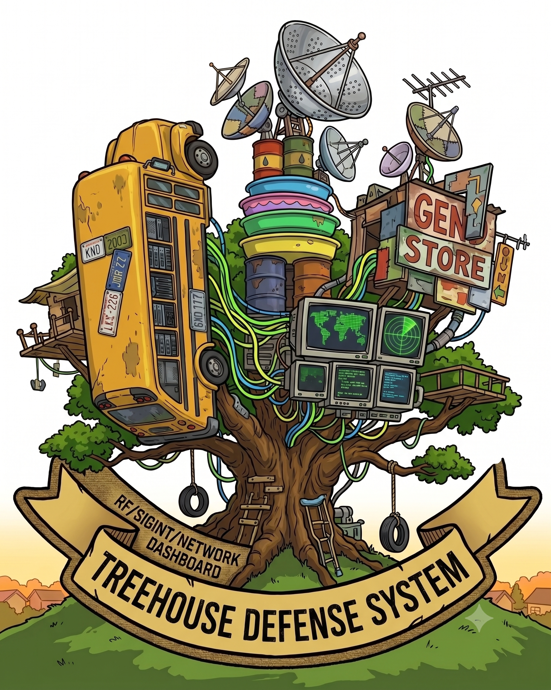
</p>

# TDS

Treehouse Defense System is a self-hosted RF awareness and presence intelligence
platform. It turns local network telemetry, passive RF observations, infrastructure
alerts, and LTE sniffing tooling into a single operator dashboard.

TDS is built for authorized environments: your home lab, your network, your SDR
hardware, your private cellular testbed, or systems you have explicit permission
to monitor.

## Steam Frame XR

**The first Steam Frame RF and wireless device XR/VR awareness and monitoring
dashboard, in tabletop and life-size modes.**

<p align="center">
  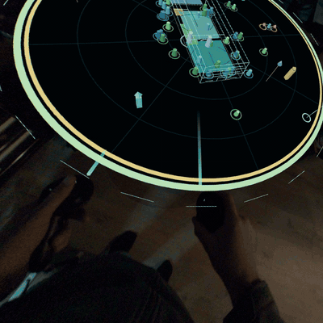
</p>

<p align="center">
  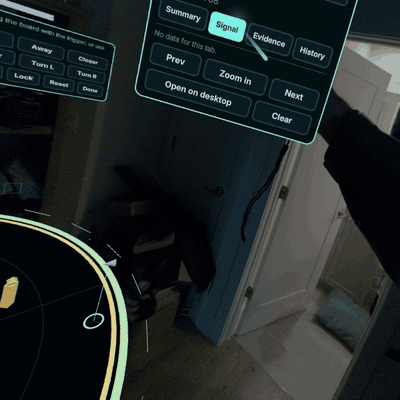
  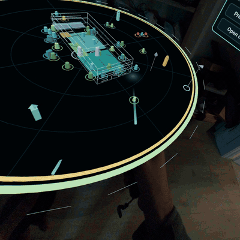
  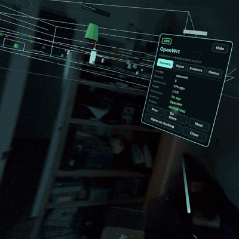
</p>

Open `/vr` in Chromium XR on the Steam Frame and the TDS map becomes a floating
board over your real room (colour passthrough, `immersive-ar`), or a life-size
site around you with aircraft at their true bearing and elevation in the sky.
Point at a Wi-Fi, BLE, unknown-RF, collector or aircraft token and pull the
trigger to open its card: summary, signal, evidence and presence history.

- **Tabletop:** grab and carry the board, scale and rotate it with two hands,
  zoom on a selection up to room scale, and lock it in place. Seated and
  standing presets.
- **Life-size:** the site at 1:1 scale around you. Look up to find aircraft;
  teleport and snap-turn with the thumbsticks.
- **Operator panels:** exceptions/alerts, selection inspector, find and jump,
  filters, legend, replay and diagnostics. Every panel can be grabbed and moved.
- **Same data as the desktop:** `/vr` uses the dashboard's own state and `/v1`
  API, and labels LIVE, CACHED, STALE, DEMO, ERROR and REPLAY data honestly.
- **Read-only:** the headset never writes to the backend.

Recorded in the headset on a Steam Frame with Framecorder, against a real TDS
backend showing LIVE data:
[30-second highlights](docs/media/tds-xr-highlights.mp4).

Tested on the hardware at 90 fps: pointing selection, the card tabs, panel
drags, grip carry, two-hand scale and life-size selection. Life-size mode isn't
aligned to your physical room yet.

### Running it on the Steam Frame

1. Install **Chromium XR** on the Frame from
   [yellkell/frameplayer](https://github.com/yellkell/frameplayer/releases), an
   unofficial build of
   [saphid/chromium-webxr-steam-frame](https://github.com/saphid/chromium-webxr-steam-frame).
   The stock SteamOS Chromium has no immersive WebXR.
2. Serve TDS over HTTPS (WebXR needs a secure context). To expose it to a
   headset read-only, use the gateway in
   [`deploy/xr-host/README.md`](deploy/xr-host/README.md).
3. Open `https://<your-host>/vr` in Chromium XR and press **Enter AR**.
   `/vr` also runs as a desktop simulator in any browser; add `?simulator=1` to
   stay in it.

| Action | Controller | Desktop simulator |
| --- | --- | --- |
| Select a token or press a button | Point and press the **trigger** (aim assist snaps to the nearest token) | Click |
| Carry the board | Hold **grip** and move the hand | `P`, then drag |
| Scale and turn | Hold **both grips** and spread or rotate the hands | `+`/`-`, `Q`/`E` |
| Scale and turn while carrying | **Thumbstick** on the holding hand | n/a |
| Summon / room scale / lock | Palette **Summon**, **Room**, **Lock** | `C`, n/a, `L` |
| Zoom in on a selection | Card **Zoom in** | `X` |
| Move a panel | Point at the bar above it, hold the trigger, move | Drag the bar |
| Tabletop or life-size | Palette **Board** / **Life-size** | Same |

## What It Does

TDS answers practical RF and infrastructure questions:

- What wireless, Bluetooth, IoT, utility, rail, and aircraft signals are visible?
- Which devices are currently present, newly seen, gone quiet, or repeatedly nearby?
- Which infrastructure alerts from UniFi or OpenWrt matter right now?
- Which sensors and collectors produced each observation?
- How does RF activity map onto a local 3D space?
- What changed over time, and how did an entity move through recent sightings?
- What does the system know about an entity across Wi-Fi, BLE, ADS-B, rail, LTE,
  network-controller data, and event history?

The system keeps normalized observations, current-state snapshots, rules/events,
presence records, source health, and selected entity history in PostgreSQL. Events
can also be published to MQTT for downstream automation.

## Core Features

- **3D RF world**: React Three Fiber scene with a wireframe site model, operator
  avatar, RF markers, BLE/Wi-Fi symbols, infrastructure source objects, airspace,
  and movable dashboard cards.
- **Steam Frame XR (`/vr`)**: WebXR tabletop board and life-size view for the
  Steam Frame, with controller selection, spatial inspector/alert cards, and a
  desktop simulator. See [Steam Frame XR](#steam-frame-xr).
- **Presence tracking**: Select entities to track, review sightings, see first/last
  seen context, RSSI proximity, co-presence, source confidence, and operator notes.
- **Replay theater**: Review chronological sighting frames for a selected entity,
  freeze 3D scene states, step through replay frames, and export scenario snapshots.
- **Link analysis graph**: Relationship map for tracked entities, sensors, alerts,
  aircraft, rail activity, IoT mesh observations, LTE/cellular context, and RF
  anomaly patterns.
- **Infrastructure alerts**: UniFi/OpenWrt alarm surfaces with live polling and
  map bleed-through effects in the 3D dashboard.
- **Collector control plane**: Dashboard-editable collector settings, USB device
  assignment, site/floor origin settings, readiness checks, and service actions.
- **LTE lab page**: LTESniffer/LibreSDR-oriented dashboard for probe, scan, and
  private-testbed live decode workflows.
- **Local-first operation**: FastAPI, PostgreSQL, MQTT, systemd user collectors,
  Docker Compose services, and no CDN JavaScript in the dashboard bundle.

## Architecture

TDS is split into a few small pieces:

- **Backend API**: FastAPI service in `backend/`, with SQLAlchemy models,
  Alembic migrations, ingestion endpoints, read APIs, rules, presence analytics,
  MQTT publishing, and static dashboard hosting.
- **Database**: PostgreSQL stores observations, current state, generated events,
  presence history, aircraft metadata, and operator decisions.
- **MQTT**: Mosquitto publishes generated events on `rf/events`.
- **Control sidecar**: A small host-control API in `control/` exposes USB inventory
  and optional systemd service actions to the dashboard.
- **Collectors**: Python scripts in `tools/` normalize source-specific data into
  TDS observations and current-state records.
- **Frontend**: React, React Three Fiber, Drei, and local UI components in
  `frontend/`, built into `backend/app/static/`.
- **Runtime**: Docker Compose for API/Postgres/MQTT/control services, with user
  systemd units/timers for hardware and source collectors.

## Data Sources

TDS is designed around source ownership: each collector contributes a clear slice
of evidence instead of every source trying to explain everything.

| Source | What TDS Collects |
| --- | --- |
| OpenWrt | Router identity, DHCP leases, host hints, interfaces, Wi-Fi associations, RSSI |
| UniFi | Network clients, AP/device context, Wi-Fi metadata, Alarm Manager webhooks |
| Kismet | Passive Wi-Fi/BLE devices, ADS-B aircraft, rtl433/utility state, datasource health |
| Intercept HTTP | RF platform health, SDR device inventory, rules/events, HTTP event state |
| Intercept MQTT | HackRF rotation / RF identity events from MQTT topics |
| WCH BLE Analyzer | BLE capture summaries and nearby identity-presence evidence |
| RTL-SDR rail collector | Rail-band RF energy observations and channel context |
| LTESniffer / LibreSDR | LTE probe/scan/live-decode state for authorized lab cellular work |

### Reference Deployment

The reference TDS deployment uses this hardware mix:

| Hardware | Role |
| --- | --- |
| 1x Intel N150 NUC-class mini PC, 16 GB RAM, 1 TB NVMe SSD | Docker Compose host, PostgreSQL, MQTT, API, dashboard, and collector control |
| 1x Alfa-class MediaTek MT7921U USB Wi-Fi/Bluetooth adapter | Active Kismet Wi-Fi monitor interface and Bluetooth datasource |
| 3x RTL-SDR Blog V3 | Dedicated SDRs for Kismet/utility RF, ADS-B aircraft, and rail-band RF collection |
| 1x HackRF Pro | Intercept sub-GHz rotation and broad RF identity/event collection |
| 1x LibreSDR B210 mini | LTE lab probe, scan, and live-decode workflows; normally attached when the LTE lab is active |
| 1x nRF52840 USB dongle | Active Kismet 802.15.4 datasource for Zigbee/Thread-style observations |
| 1x YARD Stick One | Connected RfCat-capable sub-GHz transceiver, available for future collector wiring |
| 1x WCH BLE Analyzer Pro | BLE capture hardware with multiple analyzer interfaces |
| UniFi UDM SE and OpenWrt devices | Network clients, Wi-Fi associations, DHCP/host hints, and infrastructure alerts |

Site coordinates and floor alignment are configurable from the dashboard, so a
GPS dongle is optional rather than required for a portable install.

## Screenshots

Actual view from the current deployment:

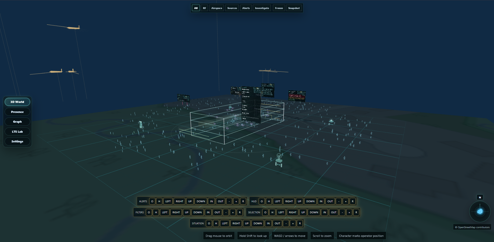

These screenshots use fictional demo data so the interface can be shown without
exposing private devices, networks, locations, credentials, or RF captures.

### 3D RF World

The 3D world gives operators a spatial view of nearby RF activity. Walk the
scene, inspect signals, check airspace, and open live context cards without
leaving the map.

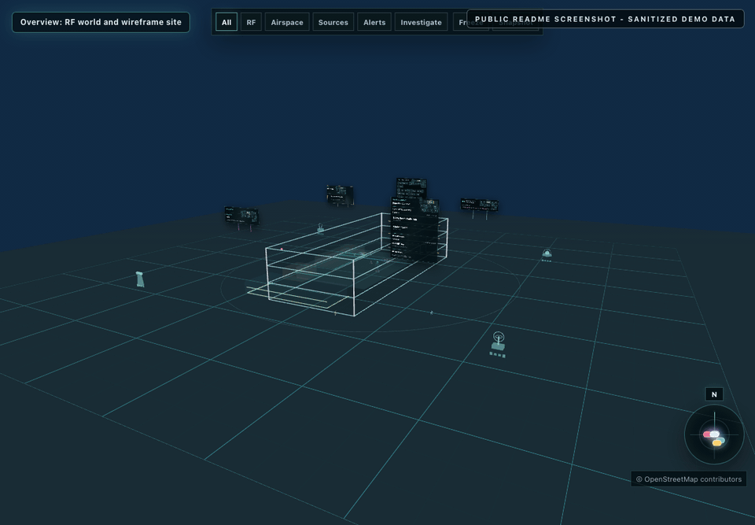

### Presence Tracking

Presence views help turn raw sightings into trackable identities, histories,
notes, replayable sighting frames, and source confidence.

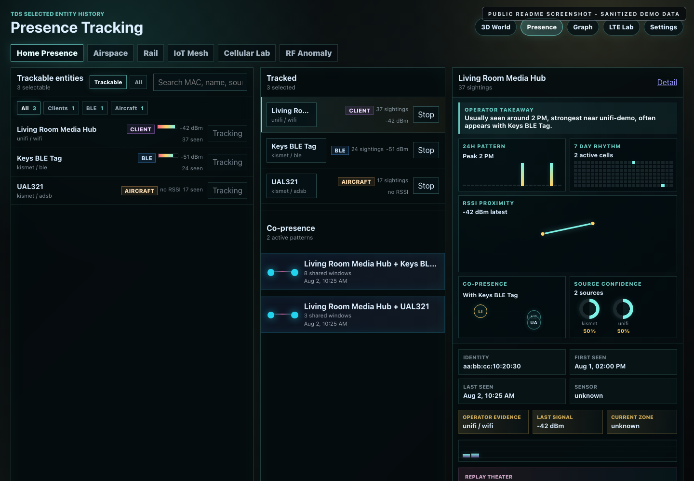

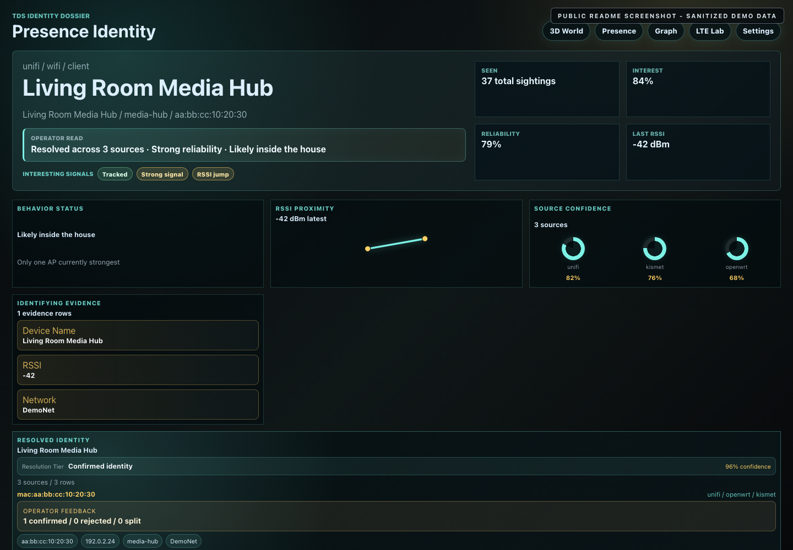

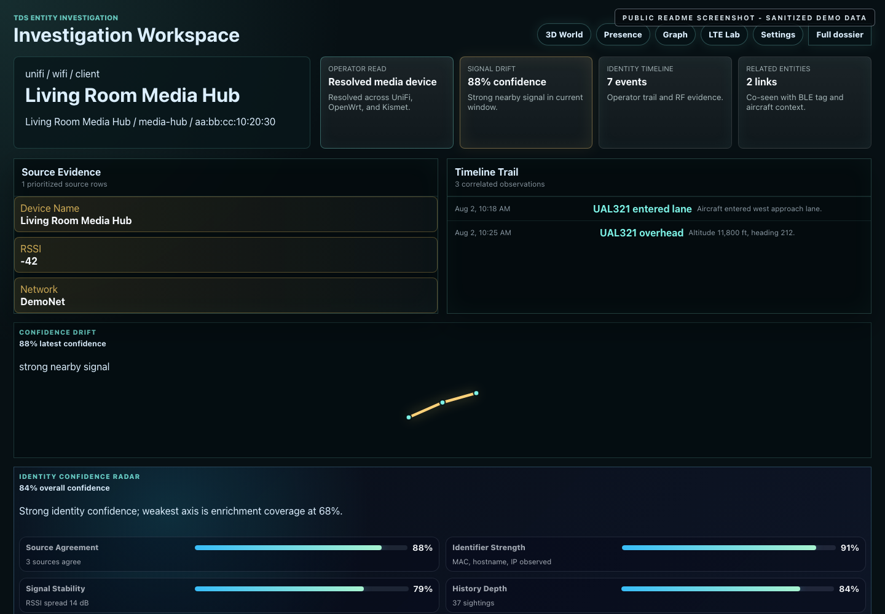

### Link Analysis

The graph view connects tracked entities, alerts, sensors, RF patterns, rail
activity, aircraft context, and evidence timelines.

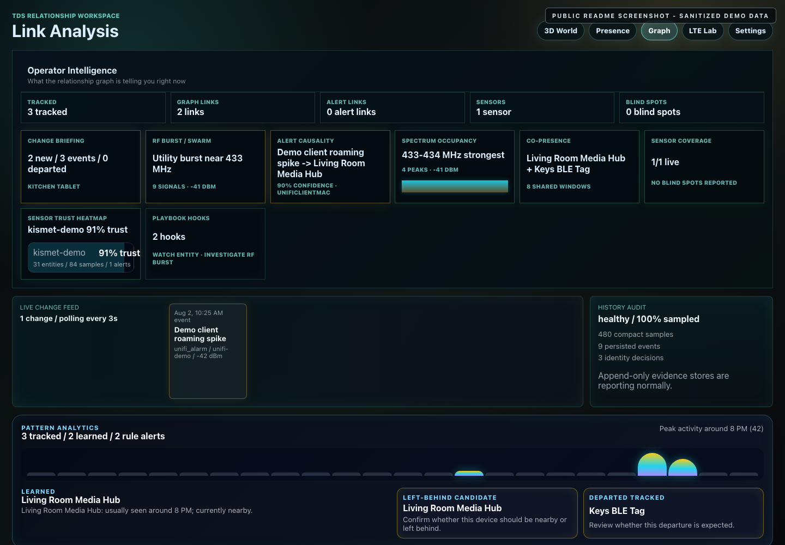

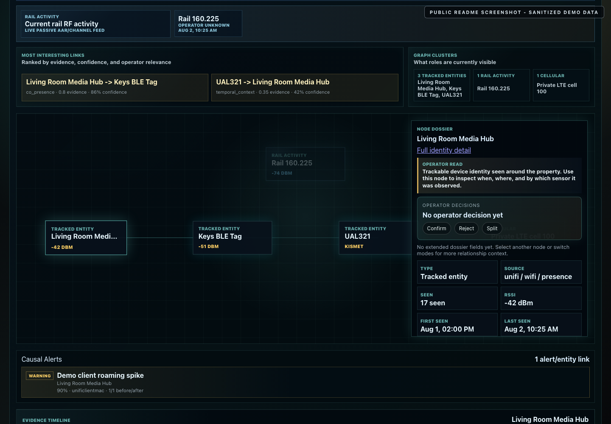

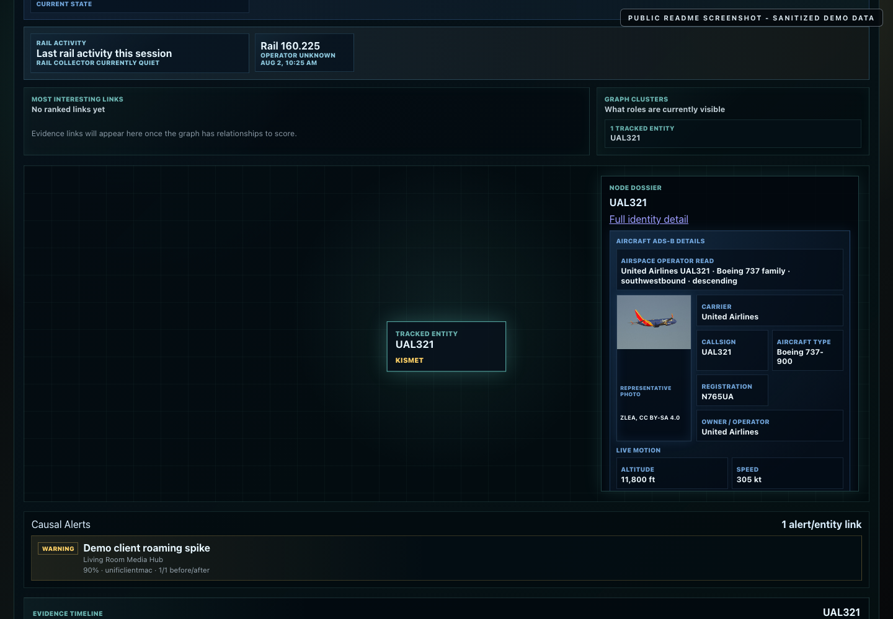

### LTE Lab

The LTE Lab page is for authorized private-cellular and SDR validation work,
including probe, scan, and live-decode workflows.

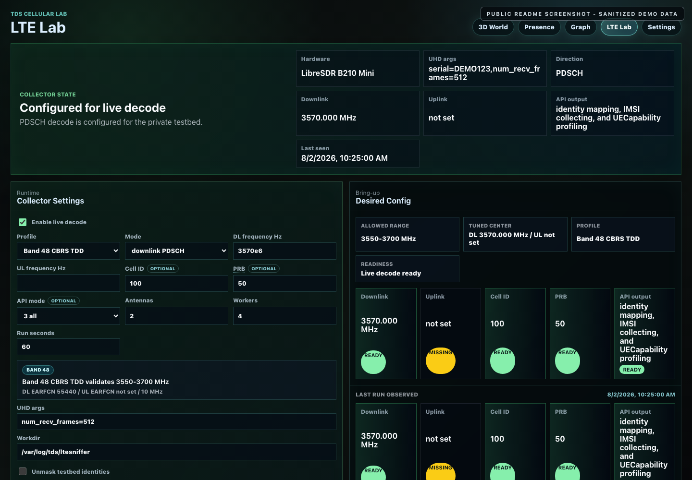

### Settings

The settings UI keeps deployment-specific details editable from the dashboard:
site origin, collector settings, USB assignments, readiness, and service control.

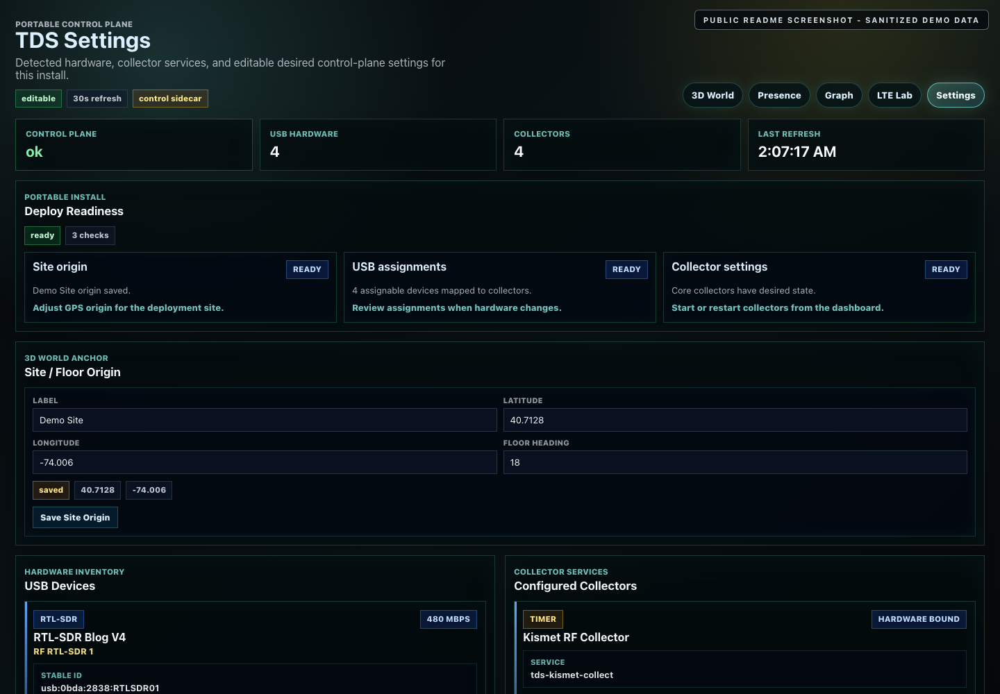


### Mobile Views

TDS also includes mobile layouts for checking the RF world, presence data,
relationship graph, LTE tools, and settings from a phone-sized screen.

| 3D world | Selected detail |
| --- | --- |
| 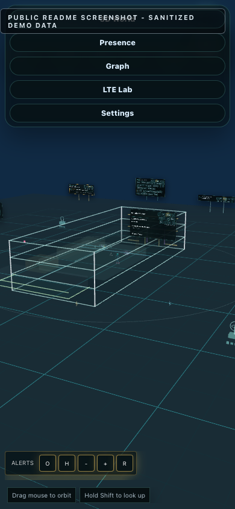 | 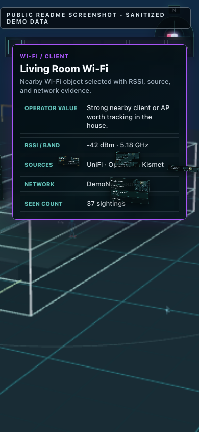 |

| Presence | Graph |
| --- | --- |
| 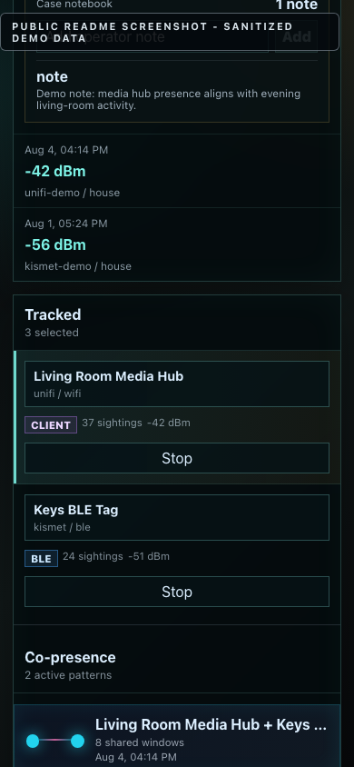 | 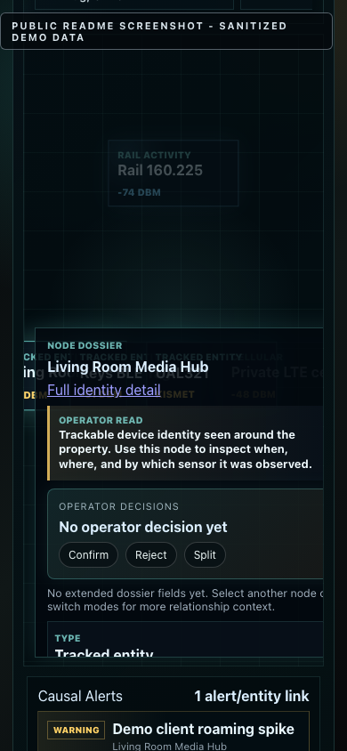 |

| LTE Lab | Settings |
| --- | --- |
| 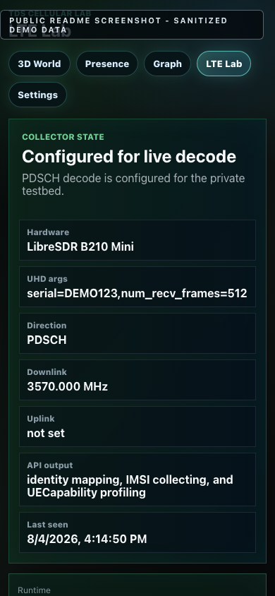 | 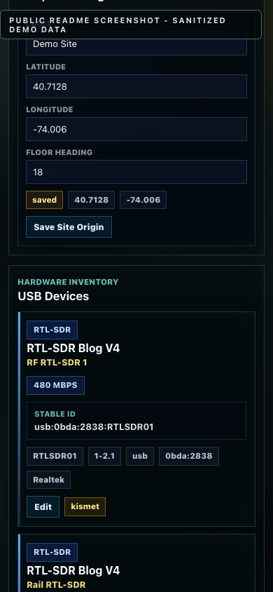 |

## Quick Start

Clone the repo, create a local config, then start the core services:

```bash
git clone https://github.com/your-org/tds.git TDS
cd TDS
cp example.env .env
docker compose up -d
```

Check the API:

```bash
curl -fsS http://127.0.0.1:8080/health
curl -fsS http://127.0.0.1:8080/ready
```

Open the dashboard:

```text
http://127.0.0.1:8080/
```

The core stack can run without all collectors configured. Go to `/settings` to
save site origin, collector endpoints, credentials, and USB device assignments.

## Configuration

TDS supports both dashboard-managed collector settings and a local `.env` file.
For a new host, start with either example file:

```bash
cp example.env .env
```

`example.env` and `.env.example` are kept identical. Dashboard settings are useful
once the web UI is online; `.env` remains the bootstrap and fallback path for
Docker Compose, user systemd collectors, and CLI runs.

The portable configuration model is:

- Use `.env` for first boot, API keys, database settings, local endpoints, and
  values needed before the dashboard is reachable.
- Use `/settings` for operator-visible desired state: site origin, collector
  settings, USB device assignments, readiness, and service actions.
- Keep secrets out of source control. The public repo contains placeholders only.

## Running Collectors

Collectors can be run manually for dry-run validation:

```bash
.venv/bin/python tools/openwrt_collect.py --dry-run
.venv/bin/python tools/unifi_collect.py --dry-run
.venv/bin/python tools/kismet_collect.py --dry-run
.venv/bin/python tools/intercept_collect.py --dry-run
```

The Kismet passive RF collector and Intercept RF platform collector are optional
but recommended when local RF sensors are attached. They normalize external RF
source payloads into the same observation, event, and current-state APIs used by
the dashboard.

User systemd units and timers live in `deploy/systemd/user/`. Install them with:

```bash
scripts/install-user-timers.sh
```

The installer renders portable service files using `TDS_ROOT` and enables the
polling timers for the non-LTE collectors. LTE live decode remains manually gated.

## Development

Frontend work lives in `frontend/`:

```bash
cd frontend
npm install
npm test
npm run build
```

The frontend build writes static assets into `backend/app/static/`, which the
FastAPI app serves directly. Runtime JavaScript and CSS are bundled locally; the
served dashboard should not load CDN scripts, remote fonts, or Stitch-hosted
assets.

## Documentation

- Operations: `docs/operations.md`
- API contract: `docs/api.md`
- OpenWrt integration: `docs/openwrt.md`
- UniFi integration: `docs/unifi.md`
- RF tooling: `docs/rf-tooling.md`
- Capture map: `docs/capture-map.md`
- XR real-backend host deployment: `deploy/xr-host/README.md`

### Utilizes

TDS builds on or integrates with these open-source projects:

- RF and network collection: [Kismet](https://www.kismetwireless.net/),
  [OpenWrt](https://openwrt.org/), [iNTERCEPT](https://github.com/smittix/intercept),
  [rtl_433](https://github.com/merbanan/rtl_433), and
  [tar1090](https://github.com/wiedehopf/tar1090)-style ADS-B metadata.
- LTE/private cellular lab workflows: [LTESniffer](https://github.com/SysSec-KAIST/LTESniffer),
  [srsRAN 4G](https://github.com/srsran/srsRAN_4G), and
  [Open5GS](https://open5gs.org/).
- Web and 3D UI: [React Three Fiber](https://github.com/pmndrs/react-three-fiber),
  [Drei](https://github.com/pmndrs/drei), and [Three.js](https://threejs.org/).
- Backend/runtime infrastructure: [FastAPI](https://fastapi.tiangolo.com/),
  [PostgreSQL](https://www.postgresql.org/), [Eclipse Mosquitto](https://mosquitto.org/),
  and [Docker Compose](https://docs.docker.com/compose/).

## Author

[Jon "GainSec" Gaines](https://gainsec.com/)
